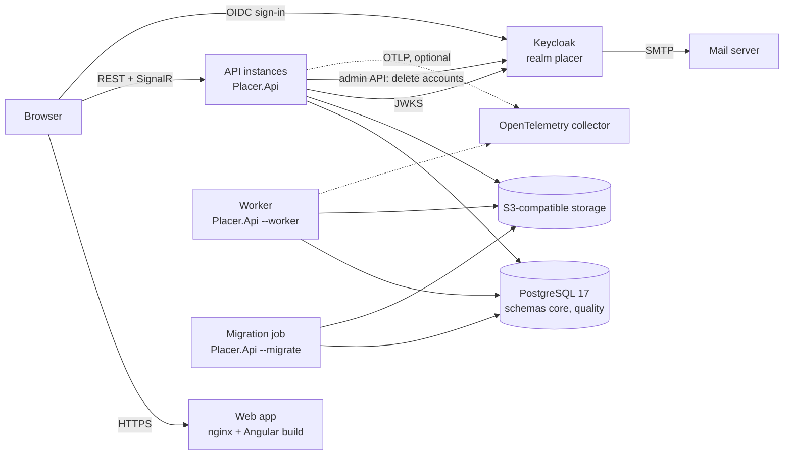
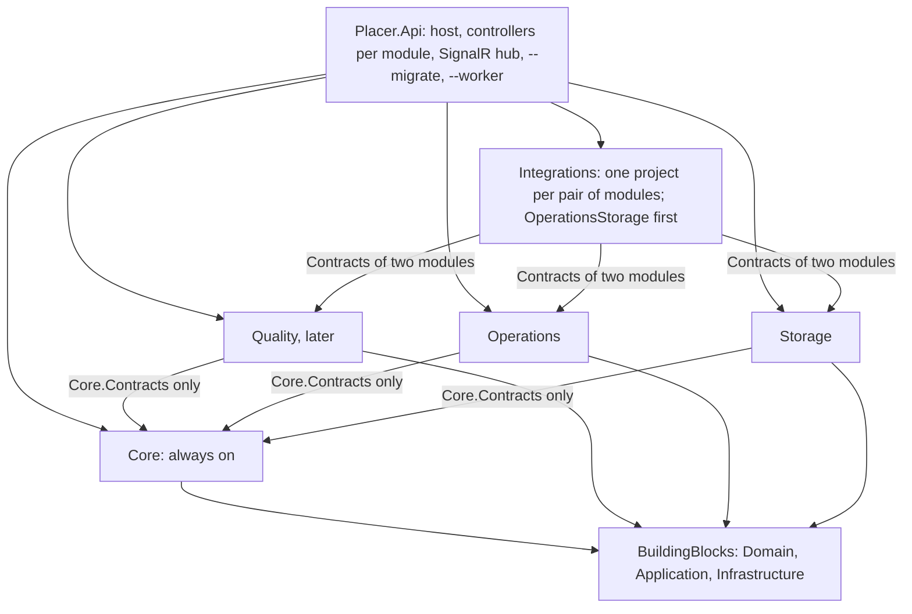
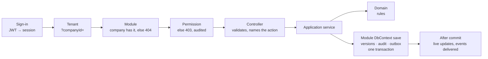
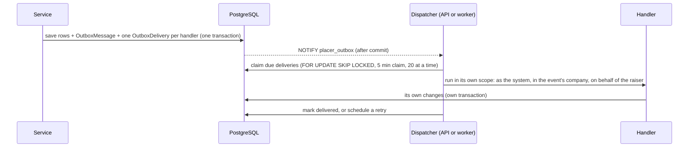
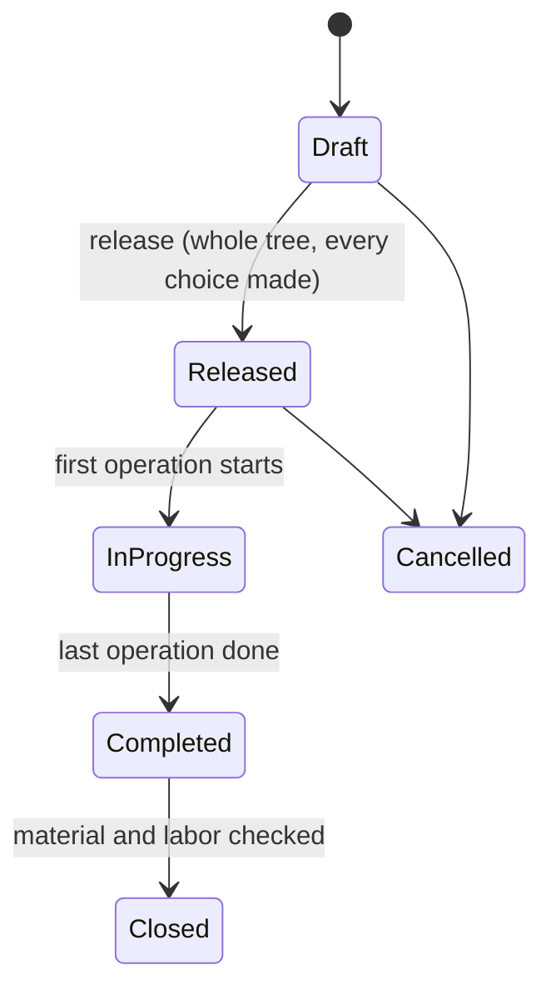
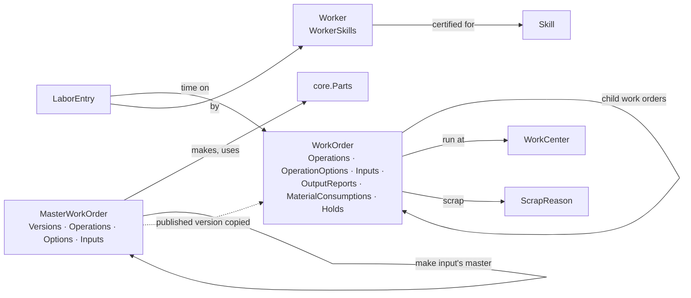

# Placer: specification

Placer is a modular manufacturing ERP. **Core** is always on. **Quality**, **Operations** and **Storage**
are sold in any combination and switched on per company. This document is the design for building it **from
scratch**: how it runs, how it is put together, and what each module does.

As of 10 November 2026. **Nothing is built yet.** The first release builds the foundation, Core, Operations (parts,
master work orders, work orders with labor) and Storage (warehouses, locations, stock and reservations). Quality and
everything else designed here comes after (section 9). The README and `web/README.md` (UI rules) are written with the
code.

## Contents

1. [Scope](#1-scope)
2. [Infrastructure](#2-infrastructure)
3. [Backend architecture](#3-backend-architecture)
4. [Frontend architecture](#4-frontend-architecture)
5. [Modules](#5-modules)
   - [How a module is defined](#51-how-a-module-is-defined)
   - [Core](#52-core)
   - Quality: section 9.7
   - [Operations](#54-operations)
   - [Storage: warehouses, locations, stock and reservations](#55-storage-warehouses-locations-stock-and-reservations)
   - [Operations and Storage together](#56-operations-and-storage-together)
6. [Order of work](#6-order-of-work)
7. [Decisions](#7-decisions)
8. [Design references](#8-design-references)
9. [Later: designed, not in the first release](#9-later-designed-not-in-the-first-release)

---

## 1. Scope

| Part | First release | What it covers |
|---|---|---|
| Foundation | Yes | Repository, BuildingBlocks, the API host and worker, migrations, Docker and Keycloak setup, architecture tests, the web app shell and theme |
| Core | Yes | Companies, members, roles and permissions, invitations, enabled modules, documents, countries, units, numbering, currency, notifications, the audit trail, personal data and company deletion; parts (with drawings and files) |
| Operations | Yes | Work centers, workers, master work orders with versions and time estimates, work order trees, the make-or-take choice, release, holds, labor entries and progress in hours |
| Storage | Yes | Warehouses and locations, stock movements and balances, reservations, the shortage list |
| Operations + Storage | Yes | Reservations from work orders, release against stock, issuing and completing into stock (section 5.6) |
| Quality | Later | Templates, inspections, inspection lots, non-conformances (section 9.7) |
| Output, material use, terminal, receiving and inspection, overhead, internationalization, Quality integrations | Later | Section 9 |

The order of work is in section 6.

---

## 2. Infrastructure

### 2.1 Runtime components



| Component | What it is | Notes |
|---|---|---|
| Web app | Angular production build served by unprivileged nginx on port 8080 | Configured when the container starts; serves `/config.json` and a strict Content-Security-Policy |
| API | ASP.NET Core (.NET 10), one image | Stateless; run any number of instances. Live updates reach every instance through PostgreSQL |
| Worker | The same image, started with `--worker` | Delivers events and runs housekeeping, with no web server; run any number |
| Migration job | The same image, started with `--migrate` | Applies every module's FluentMigrator migrations in version order and creates the storage bucket; runs before the API, never on API startup |
| File cleanup | The same image, started with `--cleanup-files [--delete]` | Lists (or deletes) stored files no record points to, older than a day; meant as a scheduled job |
| PostgreSQL 17 | One database, a schema per module (`core`, `quality`; later `operations`, `storage`) | Also carries event wake-ups (`NOTIFY placer_outbox`) and live updates (`NOTIFY placer_live`); Keycloak keeps its own database |
| Keycloak 26 | Identity only: sign-in, registration, email verification, password reset | Realm `placer`, clients `placer-web` (public, PKCE) and `placer-api-admin` (confidential, `manage-users`). The seed adds `placer-dev-tools` for scripts; it is never in the realm file |
| S3 storage | Photos, documents, logos; any S3-compatible store | SeaweedFS locally; AWS S3 or another store by configuration only |
| Mail | SMTP for Keycloak's emails | Mailpit locally |

### 2.2 Environments

**Local** (`docker compose up`): every component above, plus Mailpit. For development the API and web app usually
run outside Docker (`dotnet run`, `ng serve`); see the README.

| Service | Local address |
|---|---|
| Web app | http://localhost:4200 |
| API | http://localhost:8080 (OpenAPI at `/openapi/v1.json` in Development) |
| Keycloak | http://localhost:8180 |
| Mailpit | http://localhost:8025 |
| S3 (SeaweedFS) | http://localhost:8333 |
| PostgreSQL | localhost:5432 |

**Production target: Kubernetes.** A Deployment for the API (several replicas behind the ingress, which terminates
TLS), a Deployment for the worker, a Job for migrations run before each rollout, a CronJob for file cleanup and a
Deployment for the web app. PostgreSQL, Keycloak and S3 are managed services or their own deployments. The Compose
file already runs things this way: the migration job first, then the API with `Worker__RunInApi=false` and a
separate worker.

### 2.3 Configuration

The API reads standard ASP.NET Core configuration (JSON files, then environment variables such as
`Auth__Authority`). Development values live in `appsettings.Development.json` and `infra/seaweedfs/s3.json`; real
credentials come from a secret store.

| Setting | Meaning |
|---|---|
| `ConnectionStrings:Postgres` | The database |
| `Auth:Authority`, `Auth:Audience` | Keycloak realm URL (token issuer) and the API's audience (`placer-api`) |
| `Auth:Admin:ClientId`, `Auth:Admin:ClientSecret` | Confidential client used to delete the sign-in account of someone who deletes their account. The secret in the realm file is for development only |
| `Storage:ServiceUrl`, `Bucket`, `AccessKey`, `SecretKey`, `Region` | S3 storage; leave `ServiceUrl` empty for AWS |
| `Cors:AllowedOrigins` | The web app's origin |
| `Invitations:AcceptUrl` | The web app's invitation page |
| `Worker:RunInApi` | Whether the API also does the background work (default `true`; `false` when a worker runs) |
| `AllowedHosts` | Host names the API answers for |
| `OTEL_EXPORTER_OTLP_ENDPOINT` | Optional OpenTelemetry collector for traces, metrics and logs |

The web image takes `PLACER_API_ORIGIN`, `PLACER_API_WS_ORIGIN`, `PLACER_KEYCLOAK_URL`, `PLACER_KEYCLOAK_REALM` and
`PLACER_KEYCLOAK_CLIENT_ID`. They become `/config.json` and the origins its Content-Security-Policy allows, so one
build runs in every environment.

### 2.4 Security

- **Sign-in** is Keycloak's. The API validates JWTs (issuer, audience, signing keys); the session (the user, their
  companies, the active company, its modules and the user's permissions) is built once per request.
- **Tenancy**: every request names its company (`?companyId=`). EF query filters hide other companies' rows, and
  integration tests check that no company can reach another's data.
- **Web**: CSP with `default-src 'self'`, connections only to the API and Keycloak, `frame-ancestors 'self'`,
  `nosniff`, a strict referrer policy.
- **API**: `AllowedHosts`, CORS limited to the web origin, rate limits per caller (uploads 30 a minute, invitations
  10 a minute).
- **Files** are served only through the API after the same access checks. Each company's files live under
  `companies/{companyId}/…`. Logos are limited to 2 MB, photos to 10 MB and documents to 20 MB.
- **Invitation tokens** are secrets: the link carries them after `#`, and the API takes them only in POST bodies.
- **Personal data**: each person can export their data (`GET me/export`) or delete their account. Their records stay,
  attributed to "Deleted user", and the audit trail shows personal details only as "changed".
- **Company deletion** is scheduled, with a 30-day grace period during which owners can cancel it; housekeeping then
  purges the company's data in every module.

---

## 3. Backend architecture

### 3.1 Shape

A modular monolith: one API image and one database, with a schema per module. Inside each module the layers follow
Clean Architecture.



```
api/
  src/
    BuildingBlocks/
      Placer.BuildingBlocks.Domain           Entity, AggregateRoot, Guard, DomainException, Address, PhoneNumber,
                                         NumberFormat, Quantity, Money
      Placer.BuildingBlocks.Application      UserSession, ModuleCatalog (modules, permissions, number kinds), IRepository,
                                         IExclusiveScope, IFileStorage, auditing (AuditContext, AuditNames, IAuditLog),
                                         events (IEvent, IEventOutbox, IEventHandler), numbering (NumberKind,
                                         INumberReservation), INotificationPublisher, IHousekeepingJob, PagedResult
      Placer.BuildingBlocks.Infrastructure   ModuleDbContext, BaseRepository, interceptors (versioning, audit, outbox),
                                         the audit chain, OutboxDispatcher, Housekeeping, NumberCounters,
                                         PostgreSQL channels, S3 storage, JSON columns, DatabaseMigrator
    Modules/
      Core/      Placer.Core.Domain · .Application · .Infrastructure · .Contracts       schema core
      Operations/ Placer.Operations.Domain · .Application · .Infrastructure · .Contracts  schema operations
      Storage/    Placer.Storage.Domain · .Application · .Infrastructure · .Contracts    schema storage
      Quality/    (later)                                                           schema quality
    Integrations/ Placer.Integrations.OperationsStorage (later: OperationsQuality, StorageQuality)
    Placer.Api/                              Program, auth, Controllers/{Module}, hub, exception handler, rate limits,
                                         observability, PlacerModules (registers every module), PlacerWorker
  tests/
    Placer.Domain.Tests, Placer.Application.Tests, Placer.ArchitectureTests, Placer.Api.IntegrationTests
```

### 3.2 Rules that keep modules apart

A module **may** use BuildingBlocks and `Placer.Core.Contracts`, publish events about its own records in its own
Contracts project, publish questions and commands others may use, and refer to another module's record by id, with
a snapshot of its name for display.

A module **may not** reference another module's projects (only an integration may, and only their Contracts), read,
write or join another module's tables, or have a foreign key into another module's schema. Foreign keys may point
into `core`. Core and BuildingBlocks use no module.

Core asks modules for their part through its own contracts. For example, `ICompanyDataPurge` purges a company's
data in every module and `IPersonalDataSource` supplies each module's share of a personal data export. Core
publishes views for what others may read in the same query (`core."PersonNames"`, named in `CoreDatabase`).

`Placer.ArchitectureTests` enforce this on every build. They check project references, that each DbContext maps only
its own entities in its own schema, each controller's `[Module]`, that endpoints ask only for declared permissions
of their own module, that every permission guards something, that every change to a sellable module's records
needs a permission, and that events are declared in their module's Contracts and named after it.

Other conventions: application services per feature, no MediatR or CQRS, no FluentValidation. Requests are
validated with DataAnnotations; business rules throw `DomainException`. Only aggregate roots have repositories
(`BaseRepository<TContext, TAggregate>`).

### 3.3 What a request passes through



| Answer | When |
|---|---|
| 400 | A request that fails validation, or a broken business rule (`DomainException`); ProblemDetails with the message (with internationalization, an error code and its values instead; section 9.1) |
| 401 / 403 | Not signed in, or the role doesn't have the permission (403 is recorded in the audit trail) |
| 404 | No such record in this company, or the company doesn't have the module |
| 409 | A duplicate (unique index) or a concurrent change (row version, lock timeout) |

### 3.4 Persistence

- **One DbContext per module** (`CoreDbContext`, `QualityDbContext`) on `ModuleDbContext`, with the module's schema as
  the default. Each maps only its own tables; all of them also map the shared `core.AuditEvents`,
  `core.OutboxMessages` and `core.OutboxDeliveries`, so a module's changes, audit events and events commit together.
- **Save interceptors**, in order: aggregate versioning (a root's `xmin` changes when any of its children change),
  the audit trail, then the outbox, which wakes the dispatchers only after commit.
- **Migrations**: FluentMigrator owns the schema. Each module keeps its migrations in its Infrastructure project, and
  the runner applies all of them in version order (`M<yyyyMMddHHmmss>_<Name>`). EF Core is only the ORM; its
  configurations are written to match, and `SchemaTests` compare the EF model with the migrated database.
- **Conventions**:
  - ids are UUIDv7, made by the domain;
  - every aggregate root has `CompanyId`, filtered by the context;
  - concurrency uses PostgreSQL `xmin` (a lost race is 409);
  - times are `DateTimeOffset`, stored as `timestamptz` in UTC;
  - enums are stored as text;
  - JSON values (step configuration, answers) are `jsonb`.
- **Locks**: aggregates that take many small changes at once take the root's row lock (`LockAsync`, `SELECT … FOR
  UPDATE`, 5 s timeout). Work orders do this while labor and stock changes arrive in parallel.

### 3.5 Audit trail

Every save records what it changed in `core.AuditEvents`: who, when, the record, and the values before and after
(personal details only as "changed"). Events are hash-chained per company and append-only; a database trigger
refuses updates and deletes.

- **The action**: every endpoint is an action, named after its controller and method (`work-orders.release`) in
  its controller's module. The changes one action makes share an `ActionId`.
- **Reasons**: services add the reason a person gave (`AuditContext`).
- **Root**: each change also records the aggregate root it belongs to (`RootType`, `RootId`), so a record's history
  includes its children.
- **Background work**: event handlers act as the system on behalf of the person whose action raised the event
  (`OnBehalfOfUserId`).
- **Actions that change nothing** go in through `IAuditLog`. These are endpoints marked `[AuditRead]` (exports,
  downloads, report prints) and refusals (a missing permission). Refusals are written on their own
  connection, so a rollback doesn't erase them.
- **Renames**: the trail can't change, so if a module ever renames a record type it declares it (`AuditNames.Renamed`)
  and older events are read under the new name.
- **Where people see it**: Settings › Audit trail for admins (filters by module, action and record, CSV export,
  chain verification), and a History panel on parts, master work orders, work orders and locations.
- **Left out on purpose**: the notification bell, outbox bookkeeping and number counters. The record that got a
  number is audited.

### 3.6 Events, the outbox and background work



- **Raising**: a service raises an event with the change (`outbox.Add(new WorkOrderReleased(…))`). Events implement
  `IEvent` with a static `Name` (`operations.work-order-released`) and are declared in their module's Contracts.
- **Handlers** are registered with `services.AddEventHandler<TEvent, THandler>(module)` and recorded under a stable
  name (`operations.work-order-notifications`). A handler runs only while the company has its module. Delivery is
  at least once, so handlers must be safe to repeat.
- **Retries**: after 10 s, 20 s, 40 s and so on, at most an hour apart, then given up after 10 attempts. A handler the
  running build doesn't know counts as a failed attempt, so rolling deploys finish delivering. Delivered events are
  kept 7 days, failed ones 30.
- **Housekeeping** runs once an hour beside the dispatcher, with jobs each module adds
  (`services.AddHousekeepingJob<TJob>()`):
  - purge deleted companies after their grace period;
  - remove notifications older than 90 days;
  - remove old outbox rows.
- **Where it runs**: in the API unless `Worker:RunInApi` is false; `Placer.Api --worker` runs it with no web server. Any
  number of each can run, since a delivery is claimed by one at a time.

### 3.7 Live updates and the bell

SignalR hub at `/api/v1/hubs/notifications`, with groups per company and per user. Whichever process sends a
notification, it goes through PostgreSQL (`NOTIFY placer_live`), and every API instance relays it to the apps connected
to it.

- **System notifications** are silent hints that make open apps refetch. Each module names its own:
  `membership.changed`, `workorder.changed`, `labor.changed`, `stock.changed`. They are sent right after the save, best effort, so live refresh keeps working while the
  worker is down.
- **UI notifications** (the toolbar bell) are written by each module's event handlers (`WorkOrderNotifications`,
  `MasterNotifications`, `StockNotifications`), stored per company for 90
  days, then pushed. Someone who was away still sees what they missed. With internationalization they will be stored
  as a message key and its values instead of finished sentences (section 9.1).

### 3.8 Numbering

- **Declaring kinds**: each module declares what it numbers and the format a company starts in, as a `NumberKind`
  (key, label, prefix, digits, start):

  | Kind | Module | Starts as |
  |---|---|---|
  | `core.part` | Core | PN1000001 |
  | `operations.work-order` | Operations | MO100001; a child adds `.n` to its parent's number: MO104323.1, MO104323.1.2 |
  | `quality.inspection-lot`, `quality.non-conformance` | Quality (later) | IL100001, NC-0001 |

- **Taking a number**: a record saved without a typed number takes the next one from its company's counter
  (`core.NumberSequences`, one row per company and kind) through `TakeNumberAsync` on its repository. The counter's row
  stays locked until the record is saved, so there are no gaps and no duplicates; people creating at the same moment
  take turns. Numbers some record already has (typed by hand, imported) are skipped. `PeekNumberAsync` gives the
  hint a form shows ("Leave empty for IL100003").
- **Typed numbers** are kept, trimmed, if no other record in the company has them, whatever the case. The proposed
  rule, not yet enforced: up to 30 characters (50 for parts) of letters, digits and `- . / _`.
- **Changing the format**: admins change the prefix (up to 10 letters, digits and `- . / _`), the digits (1–12) and
  the next number under Settings › Numbering. Records keep the numbers they have.

### 3.9 Quantities, units and money

- **`Quantity`**: a decimal in a unit, stored as `numeric(18,4)` plus a unit code (0.4 m, 12 pcs, 4 g). It adds,
  subtracts and scales only within its unit and rounds to four decimals.
- **Units** are reference data in `core.Units` (`GET units`), each with a kind (count, length, mass, volume, area,
  time) and the decimals people see. There are 26, from `pcs` to `s`.
- **`Money`**: an amount in an ISO 4217 currency, kept to the cent.
- **Currency**: each company works in one currency (`Companies.CurrencyCode`, set under Settings › Company; it
  starts as the address country's currency, EUR otherwise). Every rate and cost is in it, and amounts are never
  converted.

### 3.10 Companies, roles, permissions, modules

- **Companies and members**: a person can belong to several companies with a role in each: Owner > Admin > Operator.
  Sign-up happens in Keycloak; the app then asks the person to create a company, and its creator is the owner.
  Admins invite people by link (no email sending yet), and the invitee's email must match.
- **Permissions** are declared by each module in code (`operations.masters.edit`). Each names the least role
  that has it. Endpoints ask with `[RequirePermission(…)]`, or `[RequireTenant]` for any member.
- **Modules**: Core is always on; owners switch the others under Settings › Modules (`core.CompanyModules`). New
  companies start with every module. A controller's `[Module]` answers 404 in a company without it. Turning a module
  off keeps its records, and every member's open app follows at once.
- **The session** lists each company with its modules and the member's permissions there. The web app shows pages and
  menu items by them.

### 3.11 Testing

| Suite | What |
|---|---|
| `Placer.Domain.Tests` | Aggregates and rules |
| `Placer.Application.Tests` | Services with in-memory fakes |
| `Placer.ArchitectureTests` | The rules in 3.2, on every build |
| `Placer.Api.IntegrationTests` | PostgreSQL in Testcontainers, real migrations, HTTP calls: tenant isolation, schema match, concurrency, outbox, numbering, and reservation races (two releases at once for the last stock: exactly one gets it; stock never goes below zero) |
| Web unit tests | Vitest |
| End-to-end flows | Playwright against the running stack: create a part and master, create and release a work order (with and without stock), clock on and off, issue, complete into stock |

---

## 4. Frontend architecture

### 4.1 Stack

Angular 21 with standalone components, signals and zoneless change detection; no NgModules. Angular Material 3,
`keycloak-angular` / `keycloak-js` for sign-in, `@microsoft/signalr` for live updates and Vitest for unit tests.
Mobile (Flutter) comes only if the web version succeeds, which is why the design tokens follow Material 3.

### 4.2 Structure

```
web/src/app/
  core/
    auth/           Keycloak providers, auth service, auth and access guards
    company/        company API and store (profile, logo, modules, numbering)
    config/         /config.json settings, API base URL
    http/           tenant interceptor (adds companyId), auth error interceptor, ProblemDetails, downloads
    layout/         auth layout, main layout (toolbar, side navigation, counts)
    navigation/     the side menu definition and the counts beside items
    notifications/  SignalR connection, system notification types, the bell inbox
    reference/      countries (and the currencies they use)
    routing/        company routes, title strategy, safe return URLs
    session/        session models, session service, tenant store, access rules
    theme/          System / Light / Dark
  features/
    auth, companies, account, members, documents, home,
    parts, masters (editor), work-orders (list, order, new order dialog), work-centers, workers,
    storage (locations, stock, shortages), settings (company, modules, numbering, audit)
  shared/
    audit/   History panel and audit formatting
    forms/   address and phone form helpers
    ui/      page header, stat tile, status/progress chips, avatars, callout, empty state, loading bar,
             confirm dialog, tree table (Structure views), row menu
```

### 4.3 Routing, session and access

- **Company paths**: app pages live under `/c/{companyId}/…`. A guard activates the company from the route, and
  links are built with `companyCommands()`. The tenant interceptor adds `companyId` to API requests.
- **Pages**:
  - `home`, `parts`, `masters`, `work-orders`, `work-centers`, `workers`, `storage/locations`, `storage/stock`,
    `storage/shortages`, `documents`, `members`, `account`, `companies`;
  - `settings/company`, `settings/modules`, `settings/numbering`, `settings/audit`.
- **Access**: a route or menu item declares what it needs (`data: { access: { module, permission } }`), and the
  access guard and menu hide what the session doesn't allow. The API enforces it either way.
- **Return URLs** after sign-in must pass `safeReturnUrl`.

### 4.4 Live updates

The app keeps one SignalR connection. On a system notification (`workorder.changed`, `stock.changed`, …)
open pages refetch what they show, and the menu counts refresh. On a UI notification the bell shows it. A change of
membership or modules makes the app reload the session, so the menu and pages follow at once.

### 4.5 UI rules

These rules also go into `web/README.md` when the app is set up.

- **Components**: Angular Material for every control it has; plain HTML only for layout and text.
- **Tokens only**: `--mat-sys-*` colors and type, `--placer-*` spacing, sizes, surfaces, status and data marks; no raw
  values. Material is restyled only in `_material-theme.scss`.
- **Themes**: every screen works in light and dark (`light-dark()` colors, with a high-contrast palette).
- **Look**:
  - IBM Plex Sans, with IBM Plex Mono for numbers, references and units;
  - 8 px corners on controls and 12 px on cards and dialogs;
  - 40 px controls, 44 px touch targets.
- **Shared pieces**: every page starts with `<app-page-header>`. Statuses are shown with an icon and a word, never
  by color alone. Loading uses `<app-loading-bar>`.

### 4.6 Deployment

The production build is served by nginx (`web/Dockerfile`) as an unprivileged user on port 8080. At startup it
writes `/config.json` (API origin, WebSocket origin, Keycloak URL, realm, client id) and the Content-Security-Policy
from the environment.


---

## 5. Modules

### 5.1 How a module is defined

A module is four projects (Domain, Application, Infrastructure, Contracts), a database schema and a folder of
controllers in the host. It declares itself in its Application project:

```csharp
public static ModuleDefinition Definition { get; } = new(
    Name,                       // "operations": prefix of its permissions, number kinds, and its module in the audit trail
    "Operations",               // what people call it
    "Master work orders, …",    // shown on Settings › Modules
    AlwaysOn: false,            // only Core is always on
    [/* permissions: key, label, least role */],
    [/* number kinds: key, label, prefix, digits, start */]);
```

It also brings:

- `AuditNames`: what its records and areas are called on screen, plus any renames;
- its event handlers and housekeeping jobs;
- its part of company purge and of a personal data export, through Core's contracts;
- its live notification types;
- its pages and menu section in the web app, shown when the company has it.

### 5.2 Core

**What it owns**:

- companies, with profile, logo, address, currency and enabled modules;
- people (users) and memberships with roles;
- invitations;
- the document library (documents and pinned revisions);
- reference data (countries, units);
- number counters;
- the notification inbox;
- the audit trail's search, history and verification;
- company deletion and personal data;
- later, parts.

**Tables** (schema `core`):

| Group | Tables |
|---|---|
| Companies and people | `Companies`, `Memberships`, `CompanyModules`, `Invitations`, `Users`, `Addresses` |
| Documents | `Documents`, `DocumentRevisions` |
| Reference data | `Countries`, `Units` |
| Shared | `NumberSequences`, `Notifications`, `AuditEvents`, `OutboxMessages`, `OutboxDeliveries` |
| Views | `PersonNames` |

**Permissions**:

| Key | Lets people | Least role |
|---|---|---|
| `core.members.manage` | Invite people and manage members | Admin |
| `core.company.edit` | Change the company's details, logo and numbering | Admin |
| `core.documents.manage` | Add and revise documents | Admin |
| `core.audit.view` | View and export the audit trail | Admin |
| `core.modules.manage` | Turn modules on and off | Owner |
| `core.company.delete` | Delete the company | Owner |

**Contracts** (`Placer.Core.Contracts`):

| Contract | Purpose |
|---|---|
| `IPeopleDirectory` | Members and names |
| `ICompanyDirectory` | Company names |
| `IDocumentDirectory` | Document revisions for links |
| `IMemberNotifier` | Write bell messages to a company's members, by least role |
| `ICompanyDataPurge` | Each module purges its data when a company is deleted |
| `IPersonalDataSource` | Each module's part of a personal data export |
| `IStoredFileReferences` | Which stored files are still referenced, for cleanup |
| `CoreDatabase` | The schema and view names other modules may read |

**API** (all under `/api/v1`):

| Area | Endpoints |
|---|---|
| Session and companies | `GET me`, `POST companies`, `GET/PUT company/profile`, `GET/PUT/DELETE company/logo`, `POST/DELETE company/deletion`, `POST company/leave` |
| Members and invitations | `GET company/members`, `GET company/members/{userId}`, `PUT company/members/{userId}/role`, `PUT company/members/{userId}/contact`, `DELETE company/members/{userId}`, `GET/POST company/invitations`, `DELETE company/invitations/{id}`, `POST invitations/preview`, `POST invitations/accept` |
| Modules and roles | `GET company/modules`, `POST/DELETE company/modules/{module}`, `GET company/roles` |
| Numbering | `GET company/numbering`, `PUT company/numbering/{kind}` |
| Account and personal data | `GET account`, `PUT account/contact`, `GET me/export`, `DELETE me` |
| Documents | `GET documents`, `GET documents/{id}`, `POST documents`, `POST documents/{id}/revisions`, `PUT documents/{id}`, `POST documents/{id}/archive`, `POST documents/{id}/restore`, `GET documents/{id}/revisions/{revisionId}/file` |
| Notifications | `GET notifications`, `POST notifications/{id}/read`, `POST notifications/read-all`, `DELETE notifications` |
| Audit | `GET company/audit`, `GET company/audit/export`, `GET company/audit/actions`, `GET company/audit/verify` |
| Reference data | `GET countries`, `GET units` |

**Pages**:

- Home;
- Documents;
- Members, with "What each role can do";
- My account (a language choice comes with internationalization, section 9.1);
- Companies, to switch between them;
- Settings › Company, Modules, Numbering and Audit trail.

### 5.4 Operations

Operations is how things are made and making them: master work orders and their versions, trees of work orders,
work centers, holds, workers and labor. This is the agreed design, down to the columns.

#### 5.4.1 Principles

- **Every work order makes one part.** The parts it needs come from stock or from child work orders, each making one
  of them, so a finished product is a tree of work orders.
- **Masters have versions**. A work order copies the published version when it is created
  and keeps which one, so a new version changes only future work orders.
- **Numbers are generated or typed**: MO104323 for a work order, PN1000001 for a part (section 3.8).
- **What happened is never overwritten.** Output reports, material use and labor entries are only added. The totals on
  a work order are sums of them, kept for fast lists, and a correction is a new entry with negative quantities.
- **Quantities are decimals with a unit** (`numeric(18,4)` and a unit code), so meters of bar and grams of paste work
  as well as pieces.
- **Parts live in Core**, so Storage stocks and Quality inspects the same parts Operations makes. Foreign keys stay
  inside `operations` or point to `core`, so Operations runs on its own.
- **Same conventions** as the rest: UUIDv7 ids, `CompanyId` on every root, `xmin`, `timestamptz`, enums as text.

#### 5.4.2 A master is a tree, and so is its work order

A master work order lists the operations that make its part, in order, and the parts each operation uses. A part that
is itself made has its own master, so the tree goes down until only bought parts are left. Creating a work order copies
the tree, scaled to the quantity.

The CTRL-100 master below and the work order made from it are the example used throughout the design:

```
CTRL-100 · Standard · v3 (Controller unit, makes 1 pcs)
├─ op 10 Pick and place        SMT-1 · 48/h
│  ├─ buy PCB-7  Bare board        1 pcs
│  ├─ buy R-10K  Resistor 10 kΩ   12 pcs · R1–R12
│  └─ buy SAC305 Solder paste      4 g · backflushed
├─ op 20 Reflow                OVEN-2 · 30/h
├─ op 30 Assembly              BENCH-A · 42/h
│  ├─ make HSG-2 Machined housing  1 pcs · its default master, Standard v2
│  │  ├─ op 10 Cut     SAW-1 · 38/h
│  │  │  └─ buy AL-6061 Aluminium bar 0.4 m
│  │  ├─ op 20 Mill    CNC-3 · 65/h
│  │  └─ op 30 Deburr  BENCH-B · 35/h
│  ├─ buy SCR-M3 Screw M3×8        4 pcs
│  └─ option Conformal coating     +3 min per unit
│     └─ buy COAT-1 Coating        2 ml
├─ op 40 Final test            TEST-1 · 45/h
└─ at the start (no operation)
   └─ buy LBL-1 Serial label       1 pcs

MO104323 · CTRL-100 × 50 pcs (from Standard v3)
├─ op 10 Pick and place   done · 7.5 h by 2 people · 360.00
├─ op 20 Reflow
├─ op 30 Assembly         HOLD until MO104323.1 delivers
│  ├─ make HSG-2 50 pcs: 40 from stock, 10 made by
│  │  └─ MO104323.1 · HSG-2 × 10 (from Standard v2): Cut (4 m AL-6061), Mill, Deburr
│  ├─ stock SCR-M3 200 pcs
│  └─ option Conformal coating, chosen · +150 min · COAT-1 100 ml
├─ op 40 Final test
└─ at the start: LBL-1 50 pcs
```

Quantities multiply down the tree: 0.4 m of bar per housing × 10 housings = 4 m. An input with no operation is used
when the work order starts. The consuming operation waits on a hold until a child work order delivers. Labor is
costed at the operation's rate: 7.5 h at 48/h is 360.00.

#### 5.4.3 Make it, or take it from stock

For each **make** input, Operations asks the stock contract (`IStockAvailability`) how many are free.

- **None in stock, or no Storage**: the part is made by a child work order copied from its master. Without Storage
  the fallback answers "not tracked", and there is no question and nothing to configure.
- **Some in stock**: the user chooses. They can make all of it, take what's there and make the rest (40 from stock,
  10 made), or take everything when there is enough. Choosing to make a child asks the same about the child's own
  make inputs, so the whole tree is settled before release.
- **Where the question is asked**: the create dialog shows the tree with what's in stock and asks right there. A work
  order created another way (the API, an import, later Sales) is saved as a draft with the choice open, its creator
  gets a `workorder.supply` notification, and release waits until every choice is made.
- **Parts are spoken for from creation**: every input taken from stock gets a **soft reservation** ("planned") as
  soon as the work order is created, and it follows the draft as its quantity, options and choices change. At
  **release** the soft reservations become **hard** ones, but only for stock no other released order holds, so stock
  is never promised twice. What can't be covered is **short**, and it is handled by what kind of part it is:
  - **Make parts** short: the release creates a child work order for the missing pieces, copied from the part's
    master like any other child, and releases it with the tree ("HSG-2: 40 from stock, 10 made by MO104323.2"). The
    new child's own inputs go through the same check.
  - **Buy parts** short: the release stops with a warning listing each short part, how many are missing and which
    released orders hold the rest. The person decides: cancel, or **release with short parts**. Releasing short is an
    action of its own in the audit trail, with the list of short parts. The short inputs stay marked short, and the
    operation that uses each one gets a hold ("SCR-M3: 50 short") that lifts by itself when the stock arrives
    (section 5.6).
- **Available** in the question is what's in stock minus every other order's reservations, soft and hard; an order's
  own reservations don't count against it. Without Storage the fallback still answers "not tracked", every make input
  becomes a child order and nothing is reserved.

#### 5.4.4 Master versions

Quality's inspection templates will follow the same rules later:

- **Lifecycle**: Draft → Published → Superseded, with at most one draft and one published version. Changing a
  published master starts a new draft copied from it.
- **Old versions stay**: a superseded version is read-only because work orders were made from it. Any two versions
  can be compared.
- **Version vs revision**: a version is about how the part is made; the part's revision is about what it is. Each
  version notes the drawing revision it builds.
- **No cycles**: a part may never appear below itself. This is checked when a version is published or a master is
  made default, down to 10 levels.
- **Sub-masters**: a make input follows its part's default master, at whatever version is published when the work
  order is created. An input can name another of the part's masters instead.

#### 5.4.5 Work order lifecycle



- **Without a master**: a work order can be made for any part with one operation (work center and estimate) and no
  inputs; operations and inputs can be added by hand while it is a draft. `MasterWorkOrderVersionId` stays empty.
- **While a draft**: it can change its quantity (inputs and children rescale), its operations and inputs, its options
  and its make-or-take choices. Its number can be corrected.
- **Releasing** the top of a tree releases all of it. A child is never released on its own.
- **Cancelling** cancels the children too, and is refused while one is in progress. A cancelled order is kept, with
  its reason.
- **Holds** pause a work order (or one operation) at any point before completion without changing its status. An
  open hold stops operations from starting.
- **Closing** makes a work order read-only.
- **Operations** go Waiting → Running → Paused → Done. In the first release, an operation becomes Running when the
  first person clocks on to it, and Done when someone marks it done (output reports, which would do this at the
  last operation, come later, section 9.2). The work order completes when its last operation is marked done.
- **Until output reports exist**, a child order counts as delivered to its parent when it completes, and a hold
  placed for it lifts then.
- **Children deliver to their parents**: when a child reports good output at its last operation, the parent's input
  counts it as delivered in the same transaction. Locks are taken child first, then parent.

#### 5.4.6 Aggregates and tables (schema `operations`, plus `core.Parts`)

Each root also has `Id`, `CompanyId` and `xmin`. Child tables carry their parent's id and cascade with it.



Every work order in a tree is its own aggregate, and so is every labor entry. People reporting on different work
orders, or clocking on to the same one, never wait on each other.

**`core.Parts`**: anything made, bought or stocked.

| Column | Type | Notes |
|---|---|---|
| Number | varchar(50) | Generated (PN1000001) or typed ("CTRL-100"); unique in the company, any case |
| Name | varchar(200) | "Controller unit" |
| Revision | varchar(20) null | The drawing's revision, "B" |
| Description | varchar(2000) null | |
| UnitCode | varchar(10) → core.Units | What it's counted in: pcs, m, g |
| Source | varchar(10) | Make · Buy; only make parts have masters |
| Type | varchar(20) | RawMaterial · Component · Fabricated · Assembly |
| CreatedBy, CreatedAt | uuid, timestamptz | |
| StandardCost | numeric(14,4) null | Cost of one unit in the company's currency; for buy parts what you pay, for make parts optional (otherwise the planned cost of its default master) |
| RetiredAt | timestamptz null | Kept for history, not offered |

**`core.PartDocuments`** (child of a part): the files attached to a part. The files themselves are documents in
Core's library (`Documents`, `DocumentRevisions`), so access checks, storage under `companies/{companyId}/…`, the
20 MB limit and revisions work as for any document.

| Column | Type | Notes |
|---|---|---|
| DocumentId | uuid → core.Documents | |
| DocumentRevisionId | uuid null → core.DocumentRevisions | Pinned to a revision; empty follows the latest |
| Kind | varchar(20) | Drawing · Model · Specification · WorkInstruction · Datasheet · Other |
| IsPrimaryDrawing | boolean | At most one per part: the drawing shown large on the part, on masters and at the terminal |
| DrawingRevision | varchar(20) null | For drawings: the revision printed on it; the part page warns when it differs from the part's `Revision` |
| AddedBy, AddedAt | uuid, timestamptz | |

A new drawing revision is uploaded as a new revision of the same document, so earlier ones are kept; the part's
`Revision` can be set to match in the same step.

**`WorkCenters`**: where operations happen.

| Column | Type | Notes |
|---|---|---|
| Code | varchar(30) | "SMT-1"; unique in the company |
| Name | varchar(200) | "SMT line 1" |
| Description | varchar(2000) null | |
| CapacityMinutesPerDay | int null | For scheduling, later |
| DefaultRatePerHour | numeric(12,2) null | Where a new operation's rate starts |
| DefaultOverheadRatePerHour | numeric(12,2) null | Later (section 9.3): machine overhead (amortization, energy, upkeep) per hour the machine runs; where a new operation's overhead rate starts. Empty: no overhead here. Used only while overhead costing is on |
| RetiredAt | timestamptz null | |

**`MasterWorkOrders`**: how to make one make part. A part can have several (a second line, a manual fallback), and one
is its default.

| Column | Type | Notes |
|---|---|---|
| PartId | uuid → core.Parts | A make part |
| Name | varchar(200) | "Standard", "Second line"; unique per part |
| IsDefault | boolean | At most one per part, and it needs a published version |
| CreatedBy, CreatedAt | uuid, timestamptz | |
| RetiredAt, RetiredBy | timestamptz null, uuid null | Offered for no new work orders; can be brought back |

**`MasterWorkOrderVersions`** (child):

| Column | Type | Notes |
|---|---|---|
| VersionNo | int | 1, 2, 3; unique per master |
| Status | varchar(20) | Draft · Published · Superseded |
| PartRevision | varchar(20) null | The drawing revision it builds |
| BaseQuantity | numeric(18,4) | Input quantities are per this many, usually 1 |
| ChangeNote | varchar(1000) null | "Mill replaced by laser cut" |
| CreatedBy, CreatedAt, PublishedBy, PublishedAt | | |

**`MasterOperations`** (child of a version):

| Column | Type | Notes |
|---|---|---|
| Sequence | int | 10, 20, 30, so a step can go in between |
| Name | varchar(200) | "Pick and place" |
| WorkCenterId | uuid → WorkCenters | |
| Instructions | text null | Documents attach through Core's library |
| EstimateBasis | varchar(10) | Operation · Piece · Batch: what the run estimate is for (section 5.4.7) |
| EstimateMinutes | numeric(10,4) | Run minutes (how long the operation is busy) for the whole operation, for one piece, or for one batch |
| CrewSize | numeric(5,2) | People it normally takes, default 1; planned labor = planned minutes × crew |
| BatchSize | numeric(18,4) null | Pieces per batch; required for Batch, empty otherwise |
| RatePerHour | numeric(12,2) | The operation's own labor rate, in the company's currency; starts from the work center's |
| OverheadRatePerHour | numeric(12,2) null | Later (section 9.3): machine overhead per run hour; starts from the work center's; empty: none |
| RequiredSkillId | uuid null → Skills | Later, with skills (section 9.2): only certified workers may start it |
| ReportsOutput | boolean | Good and scrap are counted here; always true on the last operation |

**`MasterOperationOptions`** (child of an operation):

| Column | Type | Notes |
|---|---|---|
| Name | varchar(200) | "Conformal coating"; unique per operation |
| ChoiceGroup | varchar(50) null | Options sharing a group are pick-one: "Color" |
| IsDefault | boolean | Ticked on a new work order unless the planner unticks it |
| ExtraEstimateMinutes | numeric | Added when chosen; the extra run time is on its operation's basis (per operation, piece or batch) |
| Instructions | text null | |

**`MasterInputs`** (child of a version):

| Column | Type | Notes |
|---|---|---|
| Sequence | int | |
| PartId | uuid → core.Parts | A buy part, or a make part a child work order makes |
| Quantity | numeric(18,6) | Per base quantity |
| UnitCode | varchar(10) → core.Units | |
| ScrapPercent | numeric(5,2) | Extra planned for losses |
| OperationSequence | int null | Used at that operation; empty: at the start |
| IssueMethod | varchar(20) | Manual · Backflush (deducted when output is reported) |
| Designators | varchar(1000) null | "R1, R2, C5" |
| OptionId | uuid null → MasterOperationOptions | Used only when that option is chosen |
| SubMasterId | uuid null → MasterWorkOrders | Make parts only: which master the children copy; empty follows the default |

**`WorkOrders`**: one order to make a quantity of one part. Each locks its own row.

| Column | Type | Notes |
|---|---|---|
| Number | varchar(30) | MO104323, or typed; a child adds `.n`; unique, any case; correctable while a draft |
| PartId | uuid → core.Parts | |
| MasterWorkOrderVersionId | uuid null | "Standard v3"; empty for one made without a master |
| ParentWorkOrderId | uuid null | Empty at the top of a tree |
| RootWorkOrderId | uuid | The top of its tree, to load a whole tree in one query |
| QuantityPlanned, UnitCode | numeric(18,4), varchar(10) | |
| QuantityGood | numeric(18,4) | Good pieces made: entered when the order completes (output reports later sum it, section 9.2) |
| QuantityScrap | numeric(18,4) | Sum of scrap over all operations |
| Status | varchar(20) | Draft · Released · InProgress · Completed · Closed · Cancelled |
| Priority | smallint | For the work center queue |
| DueDate | date null | A child starts with its parent's |
| ExternalReference | varchar(100) null | Sales order or customer PO, as text until Sales exists |
| Notes | varchar(2000) null | |
| CreatedBy/At, ReleasedBy/At, CompletedBy/At, ClosedBy/At | | |
| CancelledBy/At, CancelReason | | Cancelled with a reason and kept |

**`WorkOrderOperations`** (child, copied from the master):

| Column | Type | Notes |
|---|---|---|
| Sequence, Name, WorkCenterId, Instructions, RequiredSkillId, ReportsOutput, RatePerHour | as master | Copied, then the order's own |
| EstimateBasis, EstimateMinutes, BatchSize, CrewSize, OverheadRatePerHour | as master | Copied, so a draft can recalculate its plan when its quantity changes |
| PlannedRunMinutes | numeric(12,2) | Estimate (with options' extra) × 1, × quantity, or × batches rounded up (section 5.4.7) |
| Status | varchar(20) | Waiting · Running · Paused · Done |
| QuantityGood, QuantityScrap | numeric(18,4) | Later (section 9.2): sums of its output reports |
| LaborMinutes, LaborCost | numeric(12,2) | Sums of labor logged on it |
| RunMinutes, OverheadCost | numeric(12,2) | Later (section 9.3): sums of its run periods; overhead stays 0 while overhead costing is off |
| StartedAt, FinishedAt | timestamptz null | |

**`WorkOrderOperationOptions`** (child): the chosen options, copied (`MasterOperationOptionId`, name, extra times,
instructions). They are chosen at creation and can be changed while the order is a draft.

**`WorkOrderInputs`** (child, copied and scaled):

| Column | Type | Notes |
|---|---|---|
| PartId, UnitCode, IssueMethod, Designators | as master | |
| WorkOrderOperationOptionId | uuid null | The option it came with; unticking the option drops it |
| OperationSequence | int null | Empty: used when the first operation starts |
| QuantityRequired | numeric(18,4) | Input × order quantity ÷ base quantity, plus scrap |
| Supply | varchar(20) | Stock · Make · Undecided |
| QuantityFromStock | numeric(18,4) | The plan: all of it for Stock, part of it when taking what's there. Storage's reservation is what is actually held |
| ChildWorkOrderId | uuid null → WorkOrders | The child that makes the rest |
| QuantityDelivered | numeric(18,4) | Good pieces the child has handed over |
| QuantityIssued, QuantityReturned | numeric(18,4) | Kept from Storage's issue and return movements; used = issued − returned (material consumption later, section 9.2) |

**`Holds`** (child):

| Column | Type | Notes |
|---|---|---|
| WorkOrderOperationId | uuid null | One operation, or the whole order when empty |
| Reason | varchar(500) | "Waiting for MO104323.1 (10 HSG-2)" |
| Source, SourceReference | varchar(50), uuid null | Manual · Child · Storage (short buy part) · Quality (inspection lot, later), and that record, so whoever placed it can lift it |
| PlacedBy/At, ReleasedBy/At | | Open while `ReleasedAt` is empty |

**`Workers`**: anyone on the floor, with or without a login.

| Column | Type | Notes |
|---|---|---|
| BadgeNumber | varchar(30) | Unique in the company; scanned at a terminal later |
| Name | varchar(200) | |
| UserId | uuid null → core.Users | When the worker also signs in |
| RetiredAt | timestamptz null | Their entries stay |

**`LaborEntries`**: time on an operation, started and stopped from the work order ("Clock on", "Clock off") or
entered afterwards; the shop floor terminal (section 9.2) will start and stop them too. Several workers can
work on the same operation at once. The entry copies the operation's rate when it starts, so a later rate change
never rewrites what was spent.

| Column | Type | Notes |
|---|---|---|
| WorkerId | uuid → Workers | |
| WorkOrderId, WorkOrderOperationId | uuid | |
| Kind | varchar(20) | Run · Rework (setting up is an operation of its own) |
| StartedAt, EndedAt | timestamptz, null | Open while the worker is clocked on; at most one open entry per worker |
| Minutes | numeric(10,2) null | Set when it ends |
| RatePerHour | numeric(12,2) | Copied when it starts |
| Cost | numeric(12,2) null | Minutes ÷ 60 × rate |
| Note | varchar(500) null | |

Labor entries are never edited or deleted once ended; a mistake is corrected with a new entry of negative minutes
(with a note), as with every other record of what happened.

#### 5.4.7 Time estimates and progress

Every master operation estimates how long it runs, on one of three bases, and the crew it takes. There is no separate
setup time: setting up a machine is an operation of its own ("Set up SMT line", estimated per operation), so it is
planned, clocked and costed like any other work.

| Basis | The estimate is for | Planned run minutes for quantity Q |
|---|---|---|
| Operation | The whole operation, whatever the quantity (pack, a fixed test cycle) | EstimateMinutes |
| Piece | One piece | EstimateMinutes × Q |
| Batch | One batch of BatchSize pieces (a panel, an oven load) | EstimateMinutes × ⌈Q ÷ BatchSize⌉; a part-filled batch counts as a whole one |

- **Planned minutes** for a work order operation = `PlannedRunMinutes`, with the chosen options' extra added on the
  same basis. They are worked out when the order is created and again whenever a draft's quantity
  or options change; after release they are fixed.
- **Estimates are run time**: how long the operation is busy. **Planned labor** is planned minutes × `CrewSize`: a
  crew of two for 3 hours is 6 labor hours. With the default crew of 1 the two are the same.
**Progress** (adds to section 5.4.7):

- **Progress is hours, not pieces**: an operation's progress is `LaborMinutes ÷ planned labor minutes`. A work order's
  is the sum over its operations, and a child order's progress rolls into its parent the same way. Good and scrap
  counts join it as output once output reports come (section 9.2).
- **Over the estimate**: labor beyond the plan is shown as over (the bar stays full and the difference is shown); it
  is never capped away.
- **Done operations** count as their full planned minutes toward the order's progress, so an order that finishes
  under its estimates still reaches 100%. The difference between spent and planned is shown as the variance.
- **Planned labor cost** is planned labor minutes ÷ 60 × the operation's rate; **spent labor cost** is the sum of the
  labor entries, each at the rate it copied.
- **Material cost**: planned is each stock input's quantity × its part's standard cost; actual is (issued − parts
  returned to Normal locations) × the unit cost each Issued movement copied when it was made. Floor scrap returned to a
  Scrap location stays in the cost: the order used it up. Child orders' costs roll into their parent. A work
  order shows labor and material side by side and in total.

Example, CTRL-100 × 50 from Standard v4:

| Op | Estimate | Crew | Planned run | Planned labor |
|---|---|---|---|---|
| 5 Set up SMT line | 15 min per operation | 1 | 15 min · 0.3 h | 0.3 h |
| 10 Pick and place | 82.5 min per batch of 25 | 2 | 2 × 82.5 = 165 min · 2.8 h | 5.5 h |
| 15 Set up oven | 15 min per operation | 1 | 15 min · 0.3 h | 0.3 h |
| 20 Reflow | 35 min per batch of 20 (one oven load) | 1 | 3 × 35 = 105 min · 1.8 h | 1.8 h |
| 30 Assembly | 6.2 min per piece; coating option +3 min per piece | 1 | 50 × 9.2 = 460 min · 7.7 h | 7.7 h |
| 40 Final test | 1.3 min per piece | 1 | 65 min · 1.1 h | 1.1 h |
| 50 Pack | 30 min per operation | 1 | 30 min · 0.5 h | 0.5 h |

#### 5.4.8 Permissions and number kinds

Number kinds: `operations.work-order` (MO, 6 digits, from 100001; children add `.n`) and `core.part` (PN, 7 digits,
from 1000001), declared once Parts exist.

The permissions aren't agreed yet. This is a starting point:

| Key (proposed) | Lets people | Least role (proposed) |
|---|---|---|
| `core.parts.manage` | Add and change parts | Admin |
| `operations.masters.edit` | Build and publish master work orders | Admin |
| `operations.work-centers.manage` | Keep work centers and workers (scrap reasons and skills later) | Admin |
| `operations.work-orders.manage` | Create, change and cancel work orders | Operator |
| `operations.work-orders.release` | Release and close work orders | Operator |
| `operations.work-orders.release-short` | Release a work order whose bought parts are short | Admin |
| `operations.output.report` | Report output and material use (later, section 9.2); place and lift holds | Operator |
| `operations.labor.log` | Clock on and off, log labor | Operator |

Still open: whether to ship Operations-specific built-in roles (planner, supervisor, operator) instead of only
Owner, Admin and Operator.

#### 5.4.9 Screens

The designs are on the work order tree canvas (section 8):

- **Master work order editor**: the same layout as a work order, saved as a master version. A header with the part,
  the master's name and its versions (v4 draft, v3 published), Compare, History and Publish. A banner says that every change is saved to the draft and that work orders keep using the published
  version until it is published. Summary tiles show planned run, planned labor, planned cost (labor and, with
  overhead costing on, machine overhead), labor with the sub-masters made too, and the count of operations and
  parts, all for a plan quantity (1, 10, 50 or 200 pieces). Tabs: Structure, Options, Versions, Used by.
  - **Structure**: the same indented table as a work order: the master, its operations, their parts and options,
    and under each make part the master that makes it (its sub-master), nested and read-only. Columns: the estimate
    with its basis (Operation, Piece or Batch), crew, run, labor, labor cost, overhead (only with overhead costing
    on, section 9.3) and a note; a total row for this master.
  - Every row has a menu (⋮), as on a work order, opening dialogs: on an operation, Edit operation and estimate
    (basis, run minutes, pieces per batch, crew, labor rate, overhead rate, and the sum worked
    out for the plan quantity), Add part here, Add option, Instructions, Move up or down, Remove; on a part, Edit
    quantity and use, Move to another operation, Remove; on a make part, Use another master; on the master, Add
    operation, Compare, Publish, Discard draft, History. Sub-master rows only offer to open that master.
- **Work order**: a header with the number, status, part, quantity, master version, due date and reference; summary
  tiles (progress in hours, operations, labor cost spent of planned, child orders) and tabs:
  - **Structure** (the default): the work order as an indented table, top-down like a bill of materials. Rows for the
    order, its operations and their parts, with child orders nested under the make input they supply. Columns:
    status, hours spent / planned with a bar (amber when over the estimate), work center and a note. Rows expand and
    collapse, with "Operations only" and "Problems only" filters.
  - **Activity**: what actually happened, from labor entries and holds. One lane per operation, grouped by order, one
    row per person; overlapping operations and people show as they happened. Periods: today, the last 7 days, the
    whole order. Output markers join it with output reports (section 9.2).
  - **Material**: one row per part taken from stock (child orders' too): operation, needs, reservation (planned or
    reserved, with quantity), issued, returned, scrapped, short and used (issued − returned). Selecting a row lists
    that part's stock movements for this order, with Issue, Return and Scrap buttons.
  - **Labor**: the labor entries, newest first: worker, operation, kind, start and end, minutes, cost, note; open
    entries marked as running.
  - **Holds**: open and lifted holds, with who placed them and why.

  Every row has a menu (⋮) opening dialogs: on an operation, Clock on (pick the worker), Clock off, Log labor (worker,
  run or rework, start, end, note), place or lift a hold; elsewhere part details, child order summary, print
  traveller, history. Actions the state doesn't allow are shown disabled with the reason ("Child in progress",
  "Draft only", "On hold"). Output reports and material use come with the shop floor (section 9.2).
- **Workers** (Operations): a list of workers with badge number, name and linked user, and New, Edit and Retire.
- **Parts**: a list with filters for make or buy, type and retired, a search, and columns for number, name and type,
  revision, unit, drawing revision, source, default master and available stock. Each row has a menu (⋮): Edit, New master (make parts), Copy, Retire or Bring back. Selecting a part
  opens a panel with the primary drawing shown large first (click to open a viewer with zoom and pages; "New revision"
  uploads the next one; a warning when the drawing's revision differs from the part's), the part's details, its
  other files with "Attach" (upload, or link a library document pinned to a revision), its masters with the
  default marked, where it is used, its stock history (the latest movements of the part, with a link to all of
  them on the Stock page) and its open work orders.
- **Work orders list**: child orders nested under their parents, status filter chips and a "Show child orders"
  switch.
- **New work order dialog**: a "What it takes" tree with the make-or-take choice for each make part in stock. Child
  orders appear as the user chooses, and "Create and release" stays disabled until every choice is made. Options add
  their time and parts, and shortages show (with which released orders hold the parts). Short make parts show the
  child order that release will add; short buy parts turn "Create and release" into "Release with short parts…",
  which asks for confirmation first. "Save as draft" keeps the order with its soft reservations. A planned-time summary lists each operation's hours from its estimate
  and basis, for this order and any child orders, with the planned labor cost.

### 5.5 Storage: warehouses, locations, stock and reservations

Storage is a sellable module, schema `storage`. In the first release it holds where things are and how many:
warehouses and their locations, stock per part and location, the movements that change it, and reservations for work
orders. It answers `IStockAvailability` for Operations. Receiving against purchase orders, inspection on receipt and
lots stay later (section 9.4).

**Warehouses and locations** form a tree. A **warehouse** is a building or site; a new one can start with its own
Quarantine and Scrap locations. A **location** belongs to one warehouse and has a code (unique in the
company, printed on the shelf label), a name and a kind: Normal, Quarantine or Scrap. Receiving locations come with
inspection on receipt (section 9.4); until then goods are received straight into a Normal location. Both can be added,
edited and retired; only empty ones can be retired, and a location can move to another warehouse only while empty.
Retired ones stay in the movement history.

**`Warehouses`**:

| Column | Type | Notes |
|---|---|---|
| Code | varchar(20) | "WH1"; unique in the company |
| Name | varchar(200) | "Main warehouse" |
| Note | varchar(500) null | Address or what it holds |
| RetiredAt | timestamptz null | |

**`Locations`**:

| Column | Type | Notes |
|---|---|---|
| WarehouseId | uuid → Warehouses | |
| Code | varchar(30) | "A-01"; unique in the company, any case |
| Name | varchar(200) | "Rack A · boards and passives" |
| Kind | varchar(20) | Normal · Quarantine · Scrap (Receiving comes with inspection, section 9.4); only Normal counts as available stock |
| RetiredAt | timestamptz null | |

**`StockMovements`** (only added): every change to stock. A correction is a new movement, never an edit.

| Column | Type | Notes |
|---|---|---|
| PartId | uuid → core.Parts | |
| Quantity, UnitCode | numeric(18,4), varchar(10) | Always positive; the direction is from and to |
| FromLocationId, ToLocationId | uuid null → Locations | Empty from: stock comes in; empty to: stock goes out |
| Kind | varchar(20) | Opening · Received · Moved · Issued · Returned · Output · Scrapped · Adjusted |
| ReferenceType, ReferenceId, ReferenceLabel | varchar(30), uuid null, varchar(100) null | What it was for: a work order (snapshot of its number), a delivery note, a count |
| UnitCost | numeric(14,4) null | The part's standard cost, copied on Issued and Returned movements, so a later cost change never rewrites what was spent |
| Reason | varchar(500) null | Required for Adjusted and Scrapped |
| By, At | uuid, timestamptz | |

**`StockBalances`**: quantity per part and location, kept in the same transaction as each movement, for fast reads.
A balance never goes below zero; a movement that would make it negative is refused.

**`Reservations`**: parts held for a work order input. Each work order input taken from stock has at most one.

| Column | Type | Notes |
|---|---|---|
| PartId | uuid → core.Parts | |
| WorkOrderId, WorkOrderInputId, WorkOrderNumber | uuid, uuid, varchar(30) | Ids of the Operations records, with the number as a snapshot for display |
| Quantity, UnitCode | numeric(18,4), varchar(10) | What the input takes from stock |
| Strength | varchar(10) | Soft (from creation, while the order is a draft) · Hard (from release) |
| QuantityIssued | numeric(18,4) | Issued to the work order so far |
| QuantityShort | numeric(18,4) | Hard reservations only: what wasn't free at release (buy parts released short); filled as stock arrives |
| Status | varchar(20) | Open · Issued · Released (order completed or cancelled) |
| CreatedAt, HardenedAt, ClosedAt | timestamptz | |

**Rules**:
- **Available** = stock in Normal locations − what open reservations still hold (soft and hard, less what they
  have already issued, since issued stock has left). Receiving, Quarantine and Scrap never count.
- **Soft** reservations are made when a work order is created and change with the draft (quantity, options,
  make-or-take choices). They may exceed what's available: they are a plan, shown as "planned", and they lower what
  others see as available.
- **Hard** reservations are made at release from the soft ones, covering only stock in Normal locations that no
  other hard reservation holds; they are never over-committed. What isn't covered is recorded as `QuantityShort`.
  Short make parts become new child work orders; short buy parts need the person's confirmation to release, and then
  wait with a hold on the operation that uses them (section 5.4.3). Soft reservations of other orders never block a
  release; they are plans, and the first order released gets the parts.
- **Filling short reservations**: when stock arrives (received, returned, moved into a Normal location, or freed by a
  cancelled order), it goes to the short hard reservations that have waited longest, and their holds lift once
  nothing is short.
- **Issuing** moves stock out to the work order (movement Issued, referencing it) and counts against its reservation.
- **Issued counts as used** in the first release: what a work order used is issued − returned. Unused parts go back
  as a Returned movement to a Normal location; parts damaged on the floor go back as a Returned movement to a Scrap
  location, with a reason, so they show as scrapped against the order. Floor-level use (material consumption,
  backflush as output is reported) comes later (section 9.2) and adds to these records without changing them.
- **Completing** a top-level work order asks how many good pieces were made and where to put them (movement Output,
  in the made part). Child orders deliver to their parents, not to stock. Completing or cancelling an order releases
  what's left of its reservations.
- **Starting**: a company turns Storage on with an opening count per location (movement Opening).

**Permissions** (proposed): `storage.locations.manage` (warehouses and locations, Admin), `storage.stock.move`
(receive, move, issue, return, scrap, Operator), `storage.stock.count` (counts and adjustments, Admin).

**Screen: Storage › Stock and locations** (the designed page, without the inspection and purchase-order parts):
- A tree of warehouses and their locations: "+ Warehouse" at the top, "+" on a warehouse to add a location to that
  warehouse only, and a menu (⋮) on each for edit, move to another warehouse and retire. Dialogs: New warehouse
  (code, name, note, start with Receiving, Quarantine and Scrap or with none), New location (code, name, kind), Edit,
  Move, Retire.
- Tiles: parts in stock, parts short for released orders, parts planned beyond what's available, stock in quarantine.
- **Stock** tab: for all warehouses or one warehouse, one row per part with its locations, usable quantity, reserved
  (hard and planned), available (amber when short) and where the rest is; for one location, what is in it. Row menu
  (⋮): Move, Issue to a work order, Count, Scrap; in Quarantine, Release or scrap.
- **Movements** tab: the ledger, newest first, with kind, part, quantity, from and to, reference and who.
- **Reservations** tab: per work order and part: strength (planned or reserved), quantity, issued, short, status.
- Header buttons: Receive (part, quantity, location, delivery note as text), Move stock, Count (a difference becomes
  an Adjusted movement with a reason).

**Screen: Storage › Shortages.** Everything that needs buying: one row per bought part that is short for released
orders, with how many are missing in total, since when, and which work orders wait (with their holds); below, parts
whose planned (soft) reservations exceed what's available, as an early warning. Until Purchasing exists this is the
buy list; it exports to CSV.

The Parts page shows available stock per part and its **stock history** (every movement of the part). The work order's
**Material** tab shows, per input, what it needs, its reservation, issued, returned, scrapped, short and used, with
that input's movements underneath (section 5.4.9).

### 5.6 Operations and Storage together

Operations and Storage never reference each other; the `Placer.Integrations.OperationsStorage` project connects them
through their Contracts, and only for companies that have both modules (section 3.2). Without Storage, Operations
uses the fallback: stock "not tracked", nothing reserved.

| When this happens | Announced by | The integration | Answer back |
|---|---|---|---|
| Work order created, or a draft's inputs change (`WorkOrderPlanned`) | Operations | Creates or updates the soft reservations for its stock inputs | — |
| Release requested | Operations asks `IStockReservations.Check` | Works out, under row locks on the balances, what each stock input of the tree can get and what would be short | The short make parts and buy parts. Operations creates child orders for the make parts; if buy parts are short and the person hasn't confirmed, it answers with the warning (409, the list) |
| Release confirmed (nothing short, or buy parts short and confirmed) | Operations asks `IStockReservations.Harden` | Hardens what's free; records the rest as short | Operations releases the tree and places a hold on each operation whose input is short |
| Stock arrives for a short reservation (`StockReceived`, `StockReturned`, `StockMoved`, a cancelled order's stock freed) | Storage | Fills the longest-waiting short reservations first | `LiftHold` when an input is no longer short |
| `StockIssued` to a work order | Storage | — | Operations shows the input as issued |
| `WorkOrderCompleted`, `WorkOrderCancelled` | Operations | Releases what's left of the reservations | — |
| Make-or-take question | Operations asks `IStockAvailability` | Answers available for the part, leaving out the asking order's own reservations | — |

The check and the final release are two calls because people take time to answer the warning; the release works out
the shortage again, so if more became short in between, the warning comes back.

**Release is one transaction.** Both modules' tables are in the same PostgreSQL database, so the integration runs the
release as one unit of work: it opens one connection and transaction, has the Operations and Storage contexts both
use it (each still mapping only its own schema), hardens the reservations, creates any child orders, saves the
release and the holds, and commits once. Either all of it happens or none of it does; nothing needs undoing. The
modules still don't reference each other: the integration calls their Contracts. Without Storage,
`IStockReservations` answers "not tracked" and release never waits on stock.


---

## 6. Order of work

Everything is built from scratch. Each step is one or more commits, and the app keeps working after each one.

1. **Foundation**: the repository, BuildingBlocks (Domain, Application, Infrastructure), the API host with
   `--migrate`, `--worker` and `--cleanup-files`, FluentMigrator, Docker Compose with PostgreSQL, Keycloak, SeaweedFS
   and Mailpit, the architecture tests, and CI.
2. **Core, people and companies**: sign-in, the session, companies, members, roles and permissions, invitations,
   enabled modules, tenancy filters and the tenant isolation tests.
3. **Core, shared services**: the audit trail with History panels, the outbox, dispatcher and worker, live updates and
   the bell, numbering, units and currency, documents with S3 storage, personal data export and deletion, company
   deletion.
4. **Web app shell**: Angular with Material 3, the theme (light and dark), Keycloak sign-in, the main layout with the
   menu by enabled modules, the shared UI pieces (page header, tree table, row menu, dialogs), Home, Members, My
   account, Documents and Settings.
5. **Parts** in Core: `core.Parts` and `core.PartDocuments`, the `core.part` number kind, the Parts page with
   drawings and files, standard cost, and CSV import of parts.
6. **Work centers and workers**.
7. **Master work orders**: versions, operations with time estimates (per operation, piece or batch, and crew), options
   and inputs; the editor; publish and compare; the cycle check.
8. **Work orders**: creation from a master (or without one) with scaling, child orders, the make-or-take choice, the
   lifecycle, holds, the list and the Structure view; planned labor and material cost.
9. **Labor entries**: clock on and off and log labor from the work order, labor cost at the operation's rate,
   progress in hours, and the Labor and Activity tabs.
10. **Storage**: warehouses and locations, then stock movements and balances (opening count, receive, move, count,
    scrap, issue, return), then reservations and the shortage list.
11. **Operations and Storage together**: the integration project, soft reservations at creation, release in one
    transaction (child orders for short make parts, confirmed release for short buy parts, holds that lift when stock
    arrives), the stock answer for make-or-take, issuing to work orders, the Material tab, and completing into stock.
12. **End-to-end flows and hardening**: reservation race tests, the Playwright flows (section 3.11), a permissions
    review, and the purge and personal data parts for Operations and Storage.

After the first release, section 9 lists what comes next: output and material use, the shop floor terminal,
receiving and inspection, machine overhead, internationalization, Quality and its integrations.

### 6.1 Implementation plan

**Solution layout.**

```
api/
  src/
    BuildingBlocks/  Placer.BuildingBlocks.Domain · .Application · .Infrastructure
    Modules/
      Core/          Placer.Core.Domain · .Application · .Infrastructure · .Contracts        schema core
      Operations/    Placer.Operations.Domain · .Application · .Infrastructure · .Contracts  schema operations
      Storage/       Placer.Storage.Domain · .Application · .Infrastructure · .Contracts    schema storage
    Integrations/    Placer.Integrations.OperationsStorage
    Placer.Api/          host: auth, tenant and permission checks, controllers per module, SignalR hub,
                     ProblemDetails, rate limits, OpenAPI, OpenTelemetry; modes --migrate, --worker, --cleanup-files
  tests/             Placer.Domain.Tests · Placer.Application.Tests · Placer.ArchitectureTests · Placer.Api.IntegrationTests
web/                 Angular app (section 4)
e2e/                 Playwright flows
infra/               Docker Compose, Keycloak realm, SeaweedFS config
```

**Backend components.**

| Project | Contents |
|---|---|
| BuildingBlocks.Domain | `Entity`, `AggregateRoot`, `Guard`, `DomainException` (code and values), `Quantity`, `Money`, `NumberFormat` |
| BuildingBlocks.Application | `UserSession`, `ModuleCatalog`, `IRepository`, `IFileStorage`, `AuditContext`, `IAuditLog`, `IEventOutbox`, `IEventHandler`, `INumberReservation`, `IHousekeepingJob`, `ISharedTransaction` (one connection and transaction across modules, used only by integrations) |
| BuildingBlocks.Infrastructure | `ModuleDbContext`, `BaseRepository`, save interceptors (versioning, audit, outbox), the audit hash chain, the outbox dispatcher, housekeeping, number counters, PostgreSQL LISTEN/NOTIFY channels, S3 storage, the migration runner |
| Core | Companies, memberships, invitations, modules, users, documents, countries, units, numbering, notifications, the audit trail; parts and part documents |
| Operations | `WorkCenter`, `Worker`, `MasterWorkOrder` (versions, operations, options, inputs; publish, compare, cycle check), `WorkOrder` (tree from a master or without one, make-or-take, lifecycle, holds, progress, planned cost), `LaborEntry` |
| Storage | `Warehouse`, `Location`, `StockMovement`, `StockBalance`, `Reservation`; the shortage list and opening count |
| Integrations.OperationsStorage | Soft reservations from planned work orders; the release orchestrator in one transaction; filling shortages and lifting holds; releasing reservations on completion or cancellation; the Storage answers to `IStockAvailability` and `IStockReservations` |

**Frontend components.**

| Area | Contents |
|---|---|
| `core/` | Keycloak sign-in, session and tenant store, company routing, interceptors (tenant, auth, ProblemDetails), SignalR and the bell, the menu by modules, theme |
| `shared/ui` | Page header, stat tile, status chip, tree table (Structure views), row menu (⋮), confirm and form dialogs, History panel, drawing viewer, empty state, loading bar |
| `features/` | Home, members, account, companies, documents, settings; parts; masters (editor); work orders (list, order page with Structure, Activity, Material, Labor and Holds, new work order dialog); work centers; workers; storage (stock and locations, shortages) |

**Packages.**

| Side | Need | Package |
|---|---|---|
| API | Database and ORM | `Npgsql.EntityFrameworkCore.PostgreSQL` |
| API | Migrations | `FluentMigrator`, `FluentMigrator.Runner`, `FluentMigrator.Runner.Postgres` |
| API | Sign-in (Keycloak JWT) | `Microsoft.AspNetCore.Authentication.JwtBearer` |
| API | OpenAPI | `Microsoft.AspNetCore.OpenApi` |
| API | File storage | `AWSSDK.S3` |
| API | CSV import and export | `CsvHelper` |
| API | Observability | `OpenTelemetry.Extensions.Hosting`, `OpenTelemetry.Instrumentation.AspNetCore`, `OpenTelemetry.Instrumentation.Http`, `Npgsql.OpenTelemetry`, `OpenTelemetry.Exporter.OpenTelemetryProtocol` |
| Tests | Unit, API and architecture tests | `xunit.v3`, `Microsoft.NET.Test.Sdk`, `Microsoft.AspNetCore.Mvc.Testing`, `Testcontainers.PostgreSql`, `NetArchTest.Rules`, `Shouldly` |
| Web | Framework and components | Angular 21, `@angular/material`, `@angular/cdk` |
| Web | Sign-in | `keycloak-angular`, `keycloak-js` |
| Web | Live updates | `@microsoft/signalr` |
| Web | Drawing viewer | `pdfjs-dist` |
| Web | Tests | `vitest`, `@playwright/test` |
| Infra | Containers | `postgres:17`, `quay.io/keycloak/keycloak:26`, `chrislusf/seaweedfs`, `axllent/mailpit`, `nginxinc/nginx-unprivileged` |

Built into .NET 10 and used without a package: SignalR, rate limiting, DataAnnotations, `Guid.CreateVersion7()`, the
hashing for the audit chain, and `HttpClient` for Keycloak's admin API. Not used, on purpose: MediatR, FluentValidation.

---

## 7. Decisions

**Agreed**:

- **Built from scratch**; the first release is the foundation, Core, Operations, Storage and the integration between
  them (section 1). The rest waits in section 9.
- **Reservations**: soft ("planned") from the moment a work order is created, following the draft; hard from release.
  Hard reservations are never over-committed. At release, short make parts get new child work orders; short buy
  parts raise a warning, and a person allowed to (`operations.work-orders.release-short`) decides whether to release
  with them short (then the operation waits on a hold that lifts when stock arrives).
- **Release is one transaction** across Operations and Storage, run by the integration on one database connection
  (section 5.6).
- **Issued counts as used** until material consumption exists; leftovers and floor scrap go back as returns.
- **Material cost**: each part has a standard cost; work orders show planned and actual material cost beside labor.
- **No electronic signatures.** Actions such as publishing a master or releasing a work order are recorded in the
  audit trail with who did them and when, like any other action; nobody is asked to sign in again to confirm.
- **Work orders without a master** are allowed: one operation at a chosen work center with an estimate, and inputs
  added by hand, so a small shop can start with "make 50 of these".

- **Stack**: .NET 10 modular monolith, PostgreSQL with a schema per module, Angular with Material 3, Keycloak for
  identity only, S3-compatible storage. Docker from day one, aimed at Kubernetes, with migrations as a separate step.
- **Code**: no CQRS or MediatR, no FluentValidation. DataAnnotations on requests, domain exceptions as 400. FluentMigrator
  owns the schema.
- **Modules**: they never reference each other. Shared work goes through events and contracts with fallbacks; pairs go
  through integrations.
- **Roles and modules**: built-in roles only for now (Owner, Admin, Operator), with permission sets in code. The owner
  switches modules, and new companies start with every module.
- **Languages** (later, section 9.1): English and Romanian first, with Transloco and runtime JSON translations, one scope per module; the
  language is chosen per person; the API sends error codes and notification keys, never finished sentences
  (section 9.1).
- **Live updates and events** go through PostgreSQL LISTEN/NOTIFY (no Redis or broker). Refresh hints are best effort;
  bell messages go through the outbox.
- **Operations**:
  - parts live in Core;
  - each make part has a master work order, and a make input is made by a child work order;
  - masters have versions, and a work order keeps the version it copied;
  - when a make part is in stock, the user chooses (make all, take some and make the rest, take all);
  - numbers are generated or typed (MO, PN);
  - labor is logged on the operation and costed at its rate;
  - operations have options;
  - each master operation has a run estimate per operation, per piece or per batch of a set size, and a crew size;
  - setting up a machine is its own operation, not a setup time on another one;
  - no lot or serial tracking in V1: parts have no tracking setting, and output and material use carry no lot
    numbers. Traceability (lots, then serials) comes after V1, most likely with Storage;
  - progress is labor hours spent against planned hours, not pieces counted.
- **Naming**: "work order" means only Operations' orders; Quality's sampled batches are **inspection lots**.
- **The work order screen** opens on the Structure table (an indented tree, top-down) and has an Activity tab of what
  actually happened. A bottom-up tree and a left-to-right flow were considered and stay on the canvas as references.

**Assumed** (stand unless someone objects):

- One currency per company for every rate and cost.
- MO and PN as default prefixes, with 6 and 7 digits; child orders take the parent's number plus `.1`, `.2`.
- Inputs without an operation are used when the first operation starts.
- A child's output goes straight to its parent, never through stock, so trees work without Storage. When a child
  completes with more good pieces than its parent needs, the extra go into stock (movement Output) if Storage is on.
- A make input follows its part's default master at the version published when the work order is created.
- Controllers stay in the host, in a folder per module.
- Viewing a record isn't audited; exports, downloads and report prints are.
- No admin page for failed event deliveries yet; they are logged and kept for 30 days.
- Time estimates are run time; planned labor is run time × crew size (default 1).
- Machine overhead is off by default, charged on run time (the union of the operation's labor entries) and shown
  apart from labor. Machines running unattended, with nobody clocked on, wait for explicit start and stop with
  machines and downtime.
- A Done operation counts as its full planned hours toward its order's progress; spent minus planned is shown as the
  variance.
- A part-filled batch counts as a whole batch.

**Open**:

- Attendance: time on operations and skills first; shifts and indirect time later, or from the start?
- Parts that are sometimes made and sometimes bought (a third source, "Make or buy"), so a short part at release can
  be bought instead of made.
- Unit conversion per part (bought in rolls or jars, used in pieces or grams).
- Operations-specific built-in roles (planner, supervisor, operator), or custom roles.
- Importing Keycloak's sign-in events into the audit trail, if a customer's audits ask for one place.

---

## 8. Design references

These are private design pages; ask for access.

| Page | Covers |
|---|---|
| [Module wiring](https://claude.ai/artifact/3LSSaALqdzTcosdAL1Zhfj) | How modules stay apart, one event end to end, contracts with fallbacks, what each pair does together |
| [Operations schema](https://claude.ai/artifact/W8DsmyvXByMTUuuDr9kFEq) | Section 5.4 in full, with diagrams |
| [Backend architecture](https://claude.ai/artifact/4QaSi4vhgsywkynduGfjBh) | Layers, the request pipeline, the audit trail design, the order of work |
| [Work order trees canvas](https://claude.ai/artifact/UaYA4RLUFYBvTNH4byDJqf) | Earlier screen designs for masters, work orders, the list, the new work order dialog, and the bottom-up views |
| [App design canvas](https://claude.ai/artifact/YAnV3Q62qYu6cpAdfjH962) | App shell and Home, work orders list, parts (with drawings and files), stock and locations, work order (Structure and Activity), new work order dialog, master editor with time estimates, shop floor terminal, visual language, and three reference alternatives for the work order view |

---

## 9. Later: designed, not in the first release

These parts are designed and agreed but not in the first release (section 1). They are kept here as
they were written, so they can be picked up without designing them again.

### 9.1 Internationalization

The app ships in **English** (`en`, the source language) and **Romanian** (`ro`) first. More languages are new
translation files, not code changes.

**Library: Transloco** (`@jsverse/transloco`), translations loaded at runtime as JSON. Angular's built-in i18n
(`@angular/localize`) was considered and not chosen: it builds one copy of the app per language and translates only
text written into the app, while this app must translate keys that arrive at runtime (API errors, bell
notifications, audit actions), and should switch language without a reload.

- **Files**: `web/src/assets/i18n/{lang}.json` for Core and the shell, and one scope per module
  (`quality/{lang}.json`, `operations/{lang}.json`, `storage/{lang}.json`), loaded only when the company has that
  module. Keys are dotted and named after the screen or record (`workOrders.list.title`,
  `operations.hold.reason.child`).
- **Plurals and values** use ICU message format through the Transloco message-format plugin. Romanian needs three
  plural forms (one, few, other): `{count, plural, one {# piesă} few {# piese} other {# de piese}}`.
- **In code**: the `transloco` pipe and structural directive in templates, `TranslocoService` (or its signal
  helpers) in components. No user-facing text is hard-coded; the UI rules (`web/README.md`) gain that rule.
- **Missing keys**: a unit test checks that every key in `en` exists in `ro` and the reverse; in development a
  missing key shows the key itself and logs a warning.

**Who picks the language.** Each person chooses under My account (`core.Users.Locale`, set with `PUT account/locale`, `en` or `ro`; empty follows
the browser's language, then English). It is per person, not per company, since one floor can have people who read
different languages. Changing it switches the app at once, with no reload.

**Dates, numbers and units** follow the chosen language: `ro` writes 1.234,56 and 09.11.2026, `en` writes 1,234.56
and 9 Nov 2026. `LOCALE_ID` is fixed when the app starts, so formatting goes through Transloco's locale pipes (or
`Intl`) instead of Angular's `DatePipe` and `DecimalPipe`, and Material's `DateAdapter` locale is set on every switch
so the datepicker follows. Record numbers (MO104323), part numbers and unit codes are never translated. Time zones are
unchanged: times are stored in UTC and shown in the browser's zone.

**What the API sends instead of sentences.**
- **Errors**: `DomainException` carries an error code and its values (`workOrders.release.choiceOpen`,
  `{ part: "HSG-2" }`). ProblemDetails returns them as `code` and `args` beside an English `detail` for logs; the app
  shows the translation of `errors.{code}`, falling back to the English `detail`. Validation errors
  (DataAnnotations) return a code per field the same way.
- **Bell notifications**: stored as `MessageKey` and `MessageArgs` (`jsonb`) on `core.Notifications`, rendered by
  each reader's app. Existing rows keep their English text in a fallback column until they expire after 90 days.
- **Audit trail**: actions (`inspection-lots.reject`) and record types are already keys; the app translates them for
  display. CSV exports use the exporting person's language and record it in the export's audit event.
- **Emails and printed reports** (when they come) take the recipient's language, or the printing person's.

**Not translated**: what people type (part and operation names, notes, template steps, reasons). The 21 built-in step
catalog presets are product content and are translated in each module's files.

**Sign-in**: Keycloak's own pages use its `ro` messages; the app passes `ui_locales` with the person's language so
sign-in matches.

**Type**: IBM Plex Sans and Mono cover Romanian, including ș and ț with comma below; text uses those, never the cedilla
forms (ş, ţ).

### 9.2 Shop floor: output, material use and labor

Reporting what else happens on the floor: output and scrap, material use, skills, and the terminal. Workers, labor
entries and progress in hours are in the first release (sections 5.4.6 and 5.4.7).

**Tables** (schema `operations`, additions to section 5.4.6):

**`OutputReports`** (child, only added): operation, good, scrap, `ScrapReasonId` (required when scrap > 0),
`ReportedByWorkerId`, `ReportedAt`. Good output at a child's last operation is delivered to its parent.

**`MaterialConsumptions`** (child, only added): input, quantity, `Source` (Manual ·
Backflush · Storage), recorded by and when.

**`ScrapReasons`, `Skills`**: short company lists (`Code` unique, `Name`, `Description` for skills, `RetiredAt`).

**`WorkerSkills`** (child of a worker): `SkillId`, `CertifiedOn`, `ExpiresOn` (expired skills no longer qualify).

**Later**: shifts and attendance with indirect time, machines and downtime (for OEE), and material cost rolled up the
tree next to labor cost. Each adds tables without changing the ones above.

**Screens:**

- **Shop floor terminal** (tablet at a work center): no side menu, large type and 56–72 px buttons. The worker
  signed in by badge, the running operation with its time, good, scrap and to-go counts, and the parts it uses;
  Report output, Pause and Clock off; the next operations queued at the work center, with holds and shortages shown;
  "Report a problem / place hold".
- **Work order, with the shop floor**: tiles for progress in hours, good output, scrap and cost spent of planned;
  the Structure view's planned hours become hours spent / planned with a bar (amber when over the estimate); the
  row menus add report output, log labor and record material use; and the tabs add Activity, Material and Labor.
  Earlier description:

  - **Work order**: summary tiles (progress in hours, good output, operations, scrap, cost spent of planned, child
    orders; the cost tile splits labor and machine overhead when overhead costing is on) and tabs:
    - **Structure** (the default): the work order as an indented table, top-down like a bill of materials. Rows for the
      order, its operations and their parts, with child orders nested under the make input they supply. Columns: status,
      hours spent / planned with a bar (amber when over the estimate), output, work center and a note. Rows expand and
      collapse, with "Operations only" and "Problems only" filters.
    - **Activity**: what actually happened, from labor entries, output reports and holds. One lane per operation,
      grouped by order, one row per person; overlapping operations and people show as they happened. Periods: today, the
      last 7 days, the whole order.
    - **Material**, **Labor** and **Holds**: lists of inputs, labor entries and holds (to be designed).

    Every row has a menu (⋮) of what can be done to it, each opening a dialog: report output, log labor, place or lift
    a hold, record material use, part details, child order summary, print traveller, history. Actions the state doesn't
    allow are shown disabled with the reason ("Child in progress", "Draft only").

### 9.3 Machine overhead costing

Optional costing of machine time, per run hour, beside labor.

**`OperationRunPeriods`** (child of a work order operation): when the operation was running, meaning at least one
person was clocked on to it. Overlapping people count once.

| Column | Type | Notes |
|---|---|---|
| StartedAt, EndedAt | timestamptz, null | Opens when the first person clocks on; closes when the last clocks off |
| Minutes | numeric(10,2) null | Set when it ends |
| OverheadRatePerHour | numeric(12,2) null | Copied from the operation when it opens, so a later change never rewrites the past |
| OverheadCost | numeric(12,2) null | Minutes ÷ 60 × rate; empty while overhead costing is off |

Run periods are the union of the operation's labor entries. They change under the work order's row lock whenever an
entry on that operation starts, ends, or is entered or corrected afterwards, in which case the operation's periods are
recalculated. Example: one person 10:30–14:00 and another 12:00–16:00 is 7.5 labor hours and one run period,
10:30–16:00, of 5.5 hours. With a gap (the second from 14:30), there are two periods and the gap isn't counted.

**`OperationsSettings`**: one row per company.

| Column | Type | Notes |
|---|---|---|
| OverheadCosting | boolean | Off by default. When off, overhead rates, columns and lines are hidden everywhere and no overhead is costed; run periods are still recorded. Changed under Settings › Operations by those with `operations.work-centers.manage` |

- **Machine overhead is optional.** It is costed only while the company has overhead costing on
  (`OperationsSettings`) and only for operations with an overhead rate. It is charged on run time, never on labor
  hours, so several people on one machine charge it once and one person minding several machines charges each.
  Planned overhead is planned minutes ÷ 60 × the overhead rate; spent overhead is the sum of the run periods, each at
  the rate it copied. It is shown as its own line beside labor, never mixed into it.

- **Settings › Operations**: the "Machine overhead" switch, explained in a sentence, with work center overhead rates
  edited on each work center.

### 9.4 Receiving and inspection

Stock, movements and reservations are now in the first release (sections 5.5 and 5.6). What stays here for later:
receiving against purchase orders, holding received goods in Receiving until Quality accepts their inspection lot,
quarantine driven by non-conformances, and lots. The earlier design, as written:

Storage covers where things are and how many: locations, a stock ledger (movements only added, balances as sums),
movements between locations, and reservations for released work orders (lots and serial numbers after V1). It publishes
`IStockAvailability`, which other modules ask and which has a fallback answering "not tracked" when Storage is off.
Its events include `StockReceived`, `StockIssued`, `StockMoved` and `GoodsReceived`. In V1 stock is kept per part
and location only, with no lots or serial numbers.

**Warehouses and locations** form a tree. A **warehouse** (code, name, address or note) is a building or site; a
new one can start with its own Receiving, Quarantine and Scrap locations. A **location** belongs to one warehouse and
has a code (unique in the company, printed on the shelf label), a name and a kind: Normal, Receiving, Quarantine or
Scrap. Both can be added, edited and retired; only empty ones can be retired, and a location can move to another
warehouse only while empty. Retired ones stay in the movement history. Only Normal locations count toward available stock: **available = stock in normal
locations − reserved**. Goods received wait in Receiving until Quality accepts their inspection lot; rejected or
suspect stock sits in Quarantine until released or scrapped.

**Screen (designed): Storage › Stock and locations.** A tree of warehouses and their locations ("+ Warehouse" at
the top, "+" on a warehouse to add a location to it, and a menu (⋮) on each for edit, move and retire) beside tiles for parts in stock, parts short for
released orders, stock waiting for inspection and stock in quarantine. Three tabs:
- **Stock**: for all warehouses or one warehouse, one row per part with its locations, usable quantity, reserved, available (amber when
  short) and where the rest is; for one location, what is in it. Each row has a menu (⋮): Move, Issue to a work order,
  Count, Scrap; in Quarantine, Release or scrap; in Receiving, moves wait for inspection.
- **Movements**: the ledger, newest first: received, issued, backflushed, output, moved, quarantined, scrapped,
  adjusted (from counts), each with quantity, from and to, what it was for (PO, work order, inspection lot,
  non-conformance) and who.
- **Reservations**: per work order and part, where it is taken from, reserved, issued and status (reserved, partly
  issued, issued, short).

Dialogs: Receive goods, Move stock, Count (a difference becomes an adjustment movement with a reason), Issue, Scrap,
Release from quarantine, New location. A company that turns Storage on
for a running Operations setup starts with an opening stock count; nothing is replayed. The schema is to be designed
after Operations.

### 9.5 What Operations tells others, asks and accepts

The messages Operations and Storage exchange in the first release are in section 5.6. The full list, as written:

| Message | Kind | Carries · used by |
|---|---|---|
| `WorkOrderReleased` | event | Work order, part, quantity, inputs taken from stock · Storage reserves them |
| `OperationStarted` | event | Operation, work center, worker · dashboards, later planning |
| `OperationCompleted` | event | Operation, sequence, good and scrap · Quality opens an inspection lot at an inspection point |
| `OutputReported` | event | Good, scrap, last operation, parent · Storage receives a top-level order's pieces |
| `MaterialConsumed` | event | Part, quantity · Storage, for backflushed parts |
| `WorkOrderCompleted`, `WorkOrderCancelled` | event | Final quantities · Storage releases leftover reservations |
| `PlaceHold`, `LiftHold` | command | Reason, source and its record · Quality for an inspection lot, Storage for a shortage |
| `RecordIssuedMaterial` | command | Input, quantity · the Storage integration confirms what it issued |
| `GetWorkOrderSummary` | question | Number, part, quantity, status · other modules showing a work order |
| `GetStockAvailable` | question it asks | Part · Storage answers; without Storage the fallback says "not tracked" |
| `workorder.supply` | notification | "MO104323: 40 of 50 HSG-2 in stock. Make or take?" · the creator of an order made outside the dialog |

Inspection points (which master operation needs which Quality template) belong to the Operations + Quality
integration, in its own table. Operations itself knows only holds, which work without Quality.

### 9.6 Integrations

What two modules do together lives in an integration project between them (`Placer.Integrations.OperationsQuality`,
`…OperationsStorage`, `…StorageQuality`). It uses only the two modules' Contracts and acts only for companies that
have both. Every row below is optional: without one of the modules, both keep working on their own.

| When this happens | Announced by | With both modules | Answer back |
|---|---|---|---|
| `WorkOrderReleased` | Operations | Storage issues the parts from stock (reserves at release) | `StockIssued`: Operations marks the materials issued |
| `OutputReported` | Operations | Storage puts good pieces into stock and scrap into the scrap location | `StockReceived` |
| `OperationCompleted` at an inspection point | Operations | Quality opens an inspection lot for the work order; Operations holds the next operation | `InspectionLotDecided`: the hold lifts, or the order stays on hold |
| `GoodsReceived` | Storage | Quality opens an incoming inspection lot; the stock waits as "to inspect" | `InspectionLotDecided`: accepted stock becomes available, rejected stock goes to quarantine |
| `NonConformanceClosed` for a batch | Quality | Storage releases the good pieces and scraps the bad ones, using the counts | `StockMoved` |

An integration fills a module's port (such as `IStockAvailability`) with a real answer, replacing the module's
fallback, and owns any tables of its own, such as inspection points.

### 9.7 Quality

**What it owns**: everything about inspecting. Templates and options with versions, steps and groups, attached
documents, the step catalog settings, inspections with answers and photos, inspection lots (sampled batches) and
non-conformances.

**Rules**:

- **Templates** have a kind: *template* (inspected) or *option* (extra steps for what some units come with). Each has
  an identifier unique in the company (R-200). A template has versions:
  - at most one draft and one published;
  - published versions are immutable;
  - changing one starts a new draft copied from it.

  Templates and options can be copied, retired and brought back. Any two versions can be compared.
- **Options** are linked to the templates they fit. Starting an inspection, the operator picks the unit's options,
  each at its published version, which the inspection keeps. Options can be changed until completion, and answers of
  a removed option are kept.
- **Inspections** run a published version:
  - answers are append-only and auto-saved, and the steps judge them;
  - completing records who performed it;
  - a version can refuse completion while any answer fails (`AllowCompletionWithFailures`).

  Reports are printable and exportable to CSV (at most 10,000 rows, safe against formula injection).
- **Inspection lots** are batches made here or received from a supplier: a template, options, a quantity and a
  sampling plan (sample size, acceptance number), starting from the template version's plan. Each sample is an
  inspection, started from the lot up to the sample size.
  - Accepting needs every sample inspected and no more failures than the acceptance number.
  - Rejecting needs a reason when the samples don't call for it.
  - Both record who decided. A lot entered by mistake is cancelled with a reason.
  - Numbered IL100001 unless typed.
- **Non-conformances** are raised by hand on a completed inspection (a unit, whose failed steps are the defects) or on
  an inspection lot (a batch, with the quantity affected). There is at most one per inspection or lot.
  - Any member works on them: assignee and due date, disposition (rework, scrap, use as is, return to supplier, and
    sort for a batch), root cause, corrective action and notes.
  - Rework needs a passing re-inspection, started from the record.
  - A batch closes once every affected piece is counted good or bad.
  - Closing records who closed it. One raised by mistake is cancelled with a reason.
  - Numbered NC-0001 unless the company numbers them another way.

**Tables** (schema `quality`):

| Group | Tables |
|---|---|
| Templates | `Templates`, `TemplateVersions`, `StepGroups`, `Steps`, `TemplateDocuments`, `StepCatalogSettings` |
| Inspections | `Inspections`, `StepResults`, `InspectionPhotos` |
| Lots and non-conformances | `InspectionLots`, `NonConformances`, `NonConformanceNotes` |

**Permissions**:

| Key | Lets people | Least role |
|---|---|---|
| `quality.inspections.run` | Run inspections | Operator |
| `quality.inspection-lots.manage` | Create, sample and cancel inspection lots | Operator |
| `quality.inspection-lots.decide` | Release or reject batches | Operator |
| `quality.non-conformances.manage` | Raise and work on non-conformances | Operator |
| `quality.non-conformances.close` | Close and cancel non-conformances | Operator |
| `quality.templates.edit` | Build and publish templates | Admin |
| `quality.step-types.choose` | Choose the step types templates use | Admin |

**Number kinds**: `quality.inspection-lot` (IL, 6 digits, from 100001) and `quality.non-conformance` (NC-, 4 digits,
from 1).

**Events** (`Placer.Quality.Contracts`) and who handles them:

| Event | Carries | Handled by |
|---|---|---|
| `quality.inspection-started` | Inspection, lot or non-conformance it belongs to | `InspectionNotifications` (bell) |
| `quality.inspection-completed` | Inspection, passed | `InspectionNotifications` |
| `quality.inspection-lot-decided` | Lot, accepted | `InspectionLotNotifications`; later the Operations and Storage integrations |
| `quality.non-conformance-raised` | Non-conformance | `NonConformanceNotifications` |
| `quality.non-conformance-assigned` | Non-conformance, assignee | `NonConformanceNotifications` |
| `quality.non-conformance-closed` | Non-conformance | `NonConformanceNotifications`; later the Storage integration |
| `quality.template-version-published` | Template, version | `TemplateNotifications` |

**API**:

| Area | Endpoints |
|---|---|
| Templates | `templates` (list, get, create, update, `copy`, `retire`, `restore`, `links`, `options`, `history`); `templates/{id}/versions` (create a draft, `publish`, `sampling`, `settings`); documents, groups and steps of a version (add, update, move, delete) |
| Step catalog | `GET step-catalog`, `PUT company/step-types` |
| Inspections | `inspections` (search, `export`, get, `history`, start); `steps/{stepId}/result`, `options`, `complete`, `report/printed`, step photos (upload, get, delete) |
| Inspection lots | `inspection-lots` (search, get, `history`, `next-number`, create, update, `samples`, `accept`, `reject`, `cancel`) |
| Non-conformances | `non-conformances` (search, `assignees`, get, `history`, raise, update, `notes`, `reinspections`, `close`, `cancel`) |
| Home | `GET dashboard` (counts for the stat tiles) |

**Pages**:

- Templates: list, builder, compare versions, options;
- Inspections: list with filters, run, report;
- Inspection lots: list, details, create dialog;
- Non-conformances: list, details;
- Settings › Step types;
- Home tiles.

**Step types** (frontend):

Step types are a strategy on both sides. In the API there is one `IStepEvaluator` per type. In the web app there is
a folder per type under `features/templates/step-types` with its rules, configuration editor and answer component,
registered in the step type registry. Four come first:

| Type | Shown as | Configuration |
|---|---|---|
| Boolean | Check | The expected answer |
| Number | Measurement | Unit, minimum, maximum, target, decimals |
| Text | Text | One line or several, maximum length, a pattern the answer must match |
| Select | Multiple choice | The options (each acceptable or not; picking an unacceptable one fails the step), one or several |

File is declared but not offered yet. Any step can ask for photos (none, optional, required). A
built-in step catalog of 21 presets in four industries feeds the builder's Add step menu; companies hide what they
don't use under Settings › Step types.
